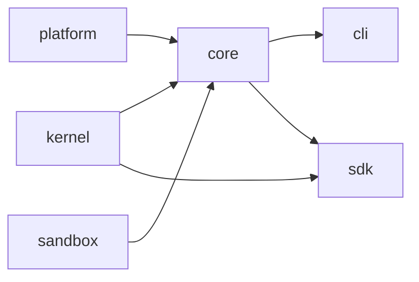

<div align="center">

<!-- The app icon carries its own dark tile, so it reads on both GitHub themes; the name is
     plain text rather than a wordmark image for the same reason (prefers-color-scheme follows
     the OS, the GitHub theme is an account setting, and a <picture> picks wrong when they differ). -->


<h1>OpenNeox</h1>

**An AI agent for coding and office work, on its own harness — terminal, desktop and phone.**<br>
Bring your own model. No account, no telemetry.

<br>

**English** · [简体中文](README.zh-CN.md)

<br>

[](https://github.com/neoxlabs/OpenNeox/actions/workflows/ci.yml)
[](LICENSE)
[](package.json)
[](#quick-start)

</div>

---

OpenNeox is the open-source edition of Neox: an AI agent for coding and office work,
running on a harness we built ourselves, with terminal, desktop and phone clients. Bring your own model key; no account, no telemetry.

The basics are all there: reading and editing code, shell, Git, MCP, skills,
sub-agents. What sets it apart:

- **Its own harness.** Agent loop, tools, context injection, compaction and sub-agents
  are our own implementation, not built on an existing agent framework. Details in
  [Harness design](#harness-design).
- **Many providers.** Native adapters for OpenAI, Anthropic, Gemini, DeepSeek, Kimi,
  GLM, Qwen, Doubao, Grok, MiniMax and others, plus local models via Ollama or LM
  Studio. A failing provider falls back to the next route; providers get health checks.
- **Remote.** Drive your computer's sessions from your phone — directly on the same
  Wi-Fi, or through a relay you host, end-to-end encrypted. Sessions, replies and the
  screenshots and charts the agent makes all show up on the phone.
- **Long-running work.** Background shell tasks, cron-style scheduled tasks and
  background sub-agents; results come back into the conversation.
- **Permissions and sandbox.** Three agent modes (read-only, confirm each step, auto)
  and three sandbox levels (read-only, workspace-write, full access); shell commands
  run in the OS sandbox (Seatbelt, bubblewrap, AppContainer).
- **Visible context.** Current usage, how far until auto-compaction, and a per-role
  breakdown, live in the status bar.
- **Undo a turn.** A shadow git repository records each turn; roll back a hunk, a file
  or the whole turn.
- **Beyond code.** Work mode produces web pages, spreadsheets and Word documents;
  Computer Use drives native apps; plugins install without an account.
- **A clay-styled UI**, and a desktop pet.
- **Built to be reworked.** The same runtime ships as an SDK — deploy it on a server
  as, say, a support bot, without writing an agent yourself.

## Why this exists

I started Neox in January this year as a way to learn how agents work, and it grew into
this. It was first used inside our company and by friends. Claude Code and Codex are
excellent, with big companies behind them; we wanted an agent we control that works well
with models like DeepSeek. Today it's enough to build a system and carry it for months of
work. Computer Use and some complex scenarios still need work.

The core — the agent loop and every tool — was written from zero. At first by hand, then
with AI help: Claude Opus 4.5, 4.6, 4.7, 4.8 and now 5.5. Early on we drove the design and
let the model write the repetitive parts; by Opus 5.5 its grasp of agent design is strong.
We also wrote with GPT 5.4, 5.5, 5.6 and 6.1, which we found too conservative, so Claude
stayed our main model. Tool design borrows from studying Claude Code, Codex and other
agents, adapted to our own use.

We keep comparing it with Claude Code and Codex on the same model and tuning the harness;
there is a [simple comparison](#simple-comparisons) below. Day to day I use a subscription plus Neox with
DeepSeek, including remote work on company tasks.

The phone app exists because I use Claude's app a lot. Especially for front-end work, the
screenshots the agent takes show up on the phone, so you can follow along away from the
computer.

It is not a fork or variant of pi, opencode or any other open-source agent; the code is
our own. The design makes trade-offs not everyone will like, but it may offer a different
experience. Model vendors now train largely around tools like Claude Code, so an
independent harness is a narrow road — still worth walking as a way to understand agents.

## Relation to neox-dev.com

[neox-dev.com](https://neox-dev.com) is Neox's website and the home of the commercial
edition, which adds sign-in and a subscription on top of this one — the subscription is a
model gateway we run, first used by friends and our own company, so you can use models
without setting up keys. Both editions are the same code: the agent, tools, desktop and
phone apps and remote access are identical. The open edition only drops what depends on
our servers: accounts and subscription, cloud sessions and the cloud Pilot. Some of that
code is still in the repository, switched off in this edition — nothing is hidden.

The open edition never contacts neox-dev.com on its own; only the Plugins page talks to
the plugin marketplace.

**Getting the open edition:**
- **Desktop (macOS / Windows) and Android**: download from
  [Releases](https://github.com/neoxlabs/OpenNeox/releases).
- **CLI and SDK**: build from source (see [Quick start](#quick-start)). The `@neoxlabs/cli`
  package on npm is the commercial edition, not this repository.

## Status

This is not a finished product, and not commercial-grade — there's no big company behind
it, the feature surface is wide and one person maintains it, so some details are rough. I
use it mainly for my own development, and many features I rarely touch. It's mostly used
with DeepSeek and GPT models. I'll keep improving it and fixing bugs — issues welcome.

My own assessment: compared with the big companies' agents, neox is still behind on tool
extensibility — parts of the right-hand workspace panel are incomplete, and Computer Use
isn't mature yet.

<p align="center">
  
</p>

## A quick tour

**Two steps to start.** Pick what you'll mostly do, then add a key — or import the
ones Claude Code and Codex already keep on this Mac.

<p align="center">
  
  
</p>

**Your models, side by side.** Any OpenAI- or Anthropic-compatible provider, plus
local models from Ollama or LM Studio. Each provider gets a health check, and the
model picker mixes them in one list.

<p align="center">
  
  
</p>
<p align="center">
  
</p>

**Run models locally.** The Local Models panel shows what fits in your memory, the
context each model is really loaded with, and whether it can call tools.
**Let the agent drive apps.** With Computer Use it reads the screen through the
accessibility tree and clicks for you — here it works the macOS Calculator.

<p align="center">
  
  
</p>

**Beyond code.** Work mode turns one request into a web page, a spreadsheet and a
Word document. Plugins add GitHub, Cloudflare, arXiv, databases and more — no account.

<p align="center">
  
  
</p>

**A workspace beside the chat.** The right panel opens files, Git, sheets, Word, PDF,
a browser, the plan, to-dos, team, a terminal, running services — and plugin panels.
Tools gathers skills, MCP, knowledge, images, plugins, the shelf of everything produced,
and agent teams.

<p align="center">
  
</p>
<p align="center">
  
</p>

**Made to be tuned.** Text size and density, the input box style, and how much the agent
may do before asking — down to stripping secrets before they reach the model.

<p align="center">
  
  
</p>

**Your computer, from your phone.** Same Wi-Fi: tap the computer and confirm the
code. Anywhere else: through a relay you host. Sessions, replies and the files the
agent made — charts included — come along.

<p align="center">
  
</p>
<p align="center">
  
  
  
  
</p>

**Terminal.** The same agent as `neox` in your repository: edits render as diffs, the
status bar shows approval mode, model, context use and cost, and `/context` breaks down
what is in the window and how much hit the cache.

<p align="center">
  
</p>
<p align="center">
  
</p>

## Harness design

Two principles run through the design: **a stable prefix** (every request should hit the
prompt cache — that's most of the cost and latency in a long session) and **no guessing**
(when unsure, fail and let the model retry rather than make a fuzzy decision for it).
Component by component:

### The agent loop

The main loop lives in `packages/kernel/src/core/runner.ts`. Iterations, tool calls and run
time are unlimited by default — the loop stops on lack of progress, not on a count:

- **Stall guard**: progress is checked every 15 s; warn at 90 s without progress, try to
  recover at 240 s (twice at most), give up at 600 s.
- **Idle guard**: once files have been changed, 5 turns in a row without a tool call end
  the run.
- **Truncation**: output cut off with `length` gets up to 3 nudges to continue.
- **Spend cap**: a per-session USD limit stops the run when reached.

Tool calls in one response are batched in order: read-only or concurrency-safe tools run
together; from the first unsafe call on, everything runs serially; writes to the same file
are serialized by a file lock; tools without a path (shell) act as a barrier. Tool errors
don't throw — they go back to the model as the tool result. Tool output per iteration is
capped at about 60% of the input budget, with head/tail truncation beyond that.

### How tools are exposed

Only about 25 high-frequency tools are always loaded (search, read, edit, write, shell,
sub-agents, web, memory, skills…). Everything else is grouped into packs that the model
unlocks with `tool_search`. Every request resends every tool schema, so fewer always-on
tools is cheaper — but a `tool_search` costs an extra model round trip, so which tools stay
loaded was decided by measured call frequency. Unlocked tools are only appended to the
end of the `tools` array, never reordered, so each unlock breaks the cache once; at most 15
are unlocked, least-recently-used first out.

### Request modes: standard and lean

How much each request carries up front comes in two settings, switchable at any time
(desktop: Request mode; CLI: `--lean`), effective from the next message:

- **Standard** (default): about 17–26K tokens up front — the full working conventions plus
  25 common tools ready to use.
- **Lean**: about 3K tokens up front — trimmed conventions plus 6 basic tools (read, write,
  edit, shell, search); the model unlocks the rest when it needs them.

The larger standard prefix is a deliberate trade-off, not waste:

1. **It is almost all cache hits.** The prefix stays the same for the whole session, so
   after the first request it is served from the prompt cache — with providers like
   DeepSeek, a cache hit costs a small fraction of normal input. The longer the session,
   the thinner it spreads; what you really pay for is what each turn adds. This assumes the
   channel keeps the cache: some third-party relays spread requests across upstreams and
   cache hits drop sharply (we measured 58% through one), so judge caching on the official
   API.
2. **Every round trip saved counts.** If a tool isn't loaded, the model has to
   `tool_search` first and then call it — a whole extra model round trip, and each unlock
   breaks the cache once. Keeping common tools loaded saves those trips.
3. **Conventions prevent rework.** Read before editing, verify after, stop and ask when
   unsure — written into the conventions, they keep the model from wandering. One wrong
   edit and redo costs far more than a few thousand prefix tokens, especially with weaker
   models.
4. **The model knows what it can do.** With the browser, Office documents and MCP in the
   list, it picks the right tool instead of improvising with the shell.

Lean suits short tasks, strong models, or when you want a faster first token. Which is
cheaper depends on how long the task is and which model you use.

### Reading and editing

- **Read**: 300 lines per chunk by default, whole file up to 2000 lines, at most 4000 lines
  per chunk; whole-file reads have a 25K-token budget, multi-file reads share 40K. A long
  document's first read returns an outline (under 8K) with anchors like `#L120-239`.
- **Read ledger**: per path and line range, the content the model was shown plus mtime and
  size. Re-reading the same range returns a short stub instead of the full text again.
  "Has the file changed since it was read?" is answered by mtime + size, not a hash.
- **Edit**: exact string replacement — `old_string` must be unique (or `replace_all` set),
  several places per call. A failed match tolerates only whitespace and blank-line
  differences; there is no "similar text" matching — better to fail and re-read than
  guess. The ledger only diagnoses a failed match (never read / stale); it does not force
  read-before-edit.

### Shell

A foreground command moves to the background after 60 s (it isn't killed), or as soon as
the user sends a message; a leading `sleep N` or known long-running commands start in the
background. When a background task ends, a completion notice is inserted before the next
model call and the agent picks it up. Output keeps the first 192 KB and last 64 KB; 16 MB
is a hard kill. With the sandbox on, commands run under Seatbelt / bubblewrap /
AppContainer, and `$()`, backticks and commands outside an allowlist are refused.

### Context injection

Per-turn facts — time, reply language, device state — are appended to the **latest user
message**, not the system prompt. The system prompt has fixed sections in a fixed order,
and is snapshotted with the tool list and model at session start so sub-agents reuse it. A
measurement-only probe hashes the system prompt each turn and records cache hits (target:
0 changes over 5 turns, ≥80% hit rate); a drop in cache reads of 5% and over 2000 tokens
versus the previous turn raises a warning. Project instructions come from
`.neox/INSTRUCTIONS.md`, `NEOX.md`, `AGENTS.md`, `.cursorrules` and `CLAUDE.md`.

### Compaction

Two levels:

- **Light** (at 60% of the window): repeated reads of a file keep only the newest, only
  the last 4 tool results are kept, old shell output is cleared; tool output over 30K
  characters goes to disk with a head/tail preview. Light passes need 48K of growth between
  them.
- **Full** (at `min(window − 33K, 85% of window)`): the summary request reuses the current
  conversation prefix — a cache hit — plus one "summarize" message, producing a
  six-section summary, up to 3 rounds, stopping when a round gains under 5%. System
  messages, the last user message and the task anchor stay verbatim; the rest becomes one
  work-record message; the plan and recently used files are re-injected. Three failures in
  a row trip a circuit breaker.

### Context between agents

Built-in sub-agents: explore, code, shell, plan. A plain sub-agent gets a lossy excerpt of
the parent conversation (up to 12K characters, tool results dropped); a forked sub-agent
gets the full parent conversation — same prefix, so the cache hits. Results come back as a
summary; agents can also message each other through inboxes on a message bus. Each has
its own read ledger; reads run concurrently, writes to the same file serialize; a
sub-agent can work in its own git worktree, removed automatically if unchanged.

### Interjecting and recovering

You can keep typing while the agent runs: by default the message waits for the turn to
end, or it can go in before the next step; pressing Enter again interrupts the streaming
model (text so far is kept, running tools are not killed). Pause takes effect only between
model calls, never halfway. If the process dies mid-run, on restart every tool call
without a result gets an "interrupted" result so the history is valid again; nothing
auto-resumes.

### Providers and retries

Each protocol has a native adapter. Streaming requests retry up to 6 times (from 1 s,
exponential, capped at 4 s, ±20% jitter); rate limits back off separately (up to 60 s);
timeouts are 30 s connect, 20 s first byte, 120 s stream idle. Repeated failures on one
provider move to the next on the route chain. Anthropic requests carry `cache_control`.

### Checkpoints

A separate shadow git repository records each turn; roll back by hunk, file or whole turn.
Rollback refuses if you edited the same file afterwards, so it never overwrites your
changes.

### UI

The desktop timeline is virtualized past 400 rows; streaming deltas are merged into one
render per frame; row heights and scroll positions are cached. The phone talks through
the relay with end-to-end encrypted envelopes — the relay only forwards ciphertext and
holds messages for an offline phone in memory for up to 24 hours.

## Simple comparisons

**To be clear up front: these are simple tests** — one short task and one long task, two
to three runs per agent. In other
scenarios and tasks every agent behaves differently, and with today's strong models agents
are broadly alike overall. These numbers describe this one task only.

### Short task

**Method.** Add an orders HTTP API to a small Node "coffee shop" project (validation,
member discount, every-10th-coffee-free loyalty, JSON persistence, its own tests and
README), graded by 25 hidden tests written and validated beforehand. 6 configurations × 3
runs, order randomized per round. Every agent called the official DeepSeek API directly
with the same key and the same model (DeepSeek V4.1 Flash, thinking high), through a local
logging proxy that recorded each request's usage and timing. Cost uses DeepSeek's official
peak prices per 1M tokens (cache hit $0.006, miss $0.30, output $1.20). Run on 2026-10-29;
versions: OpenNeox CLI (standard and lean request modes), opencode 1.18.32, pi 0.73.1,
Codex CLI (configured per DeepSeek's docs), DeepSeek Harness (headless).

**Results** (median of 3; all 18 runs passed 25/25 hidden tests):

| | First request (tools) | Cache hit | Uncached input | Output | Cost / run | Time | Requests |
|---|---|---|---|---|---|---|---|
| neox standard | 19,851 (19) | 98.0% | 7,860 | 12,769 | $0.0202 | 68.0 s | 13.3 |
| neox lean | 3,492 (8) | 96.9% | 6,222 | 15,081 | $0.0211 | 82.8 s | 14.7 |
| opencode | 10,264 (10) | 93.9% | 11,984 | 9,391 | $0.0155 | 50.4 s | 13.0 |
| pi | 4,490 (4) | 96.7% | 5,699 | 17,763 | $0.0239 | 94.0 s | 11.7 |
| Codex | 11,834 (10) | 97.4% | 16,894 | 19,155 | $0.0297 | 110.9 s | 19.7 |
| DeepSeek Harness | 9,254 (25) | 96.7% | 17,953 | 25,019 | $0.0391 | 156.3 s | 21.3 |

Cache hit rate of the **first request** of a new session: neox 94–95%, Codex 92–98%,
neox lean 62%, pi 60%, opencode 16%, DeepSeek Harness 8%. neox keeps its system prompt and
tool definitions static and puts per-session details such as the working directory after
them, so a new session still hits the cache.

**What it shows:**
- A large initial context isn't the same as expensive: every agent's input hit the cache
  94–98% of the time, and output was 69–89% of the cost. neox standard has the largest
  first request, yet its hundreds of thousands of cached tokens cost about $0.002; lean
  mode cuts the first request to 3.5K and wasn't cheaper on this task.
- opencode was fastest and cheapest here, mainly because it produced the least output.
- Time to first token was the same for all (~0.7 s), set by DeepSeek's servers.

**Limits:** one task; three runs each, so differences under ~1.5× may be noise; context
peaked around 53K, so long sessions (compaction) weren't exercised; we wrote the task.

### Long task

**Method.** From an empty directory, build a complete coffee-shop order service: HTTP API
plus CLI, menu, validated orders, member discount, loyalty stamps, a daily report, atomic
JSON persistence, its own tests and README — graded by 44 hidden tests written and
validated beforehand. Same setup as above (official DeepSeek API, same key, V4.1 Flash,
thinking high), two runs each, during peak hours, so the prices below are what was paid.
DeepSeek Harness ran as 0.2.1-rc.2 on Node 24 with its headless profile.

**Results** (median of 2):

| | Passed | Hidden tests | Time | Requests | Max context | Cache hit | Uncached input | Output | Cost / run |
|---|---|---|---|---|---|---|---|---|---|
| neox standard | 2/2 | 44, 44 | 322 s | 20.5 | 90K | 99.3% | 8.0K | 66K | $0.090 |
| neox lean | 2/2 | 44, 44 | 297 s | 31 | 71K | 99.2% | 11.2K | 61K | $0.086 |
| opencode | 2/2 | 44, 44 | 374 s | 25.5 | 85K | 98.4% | 20.7K | 71K | $0.099 |
| pi | 1/2 | 43, 44 | 441 s | 37.5 | 98K | 98.7% | 23.7K | 78K | $0.112 |
| Codex | 1/2 | 43, 44 | 249 s | 26.5 | 64K | 98.6% | 15.3K | 44K | $0.065 |
| DeepSeek Harness | 2/2 | 44, 44 | 545 s | 35 | 116K | 98.9% | 25.2K | 92K | $0.132 |

**What it shows:**
- Output drives cost: Codex produced the least and was fastest and cheapest; DeepSeek
  Harness produced the most (about 70% of it reasoning) and was slowest and most expensive.
- Over a long session neox had the highest cache hit rate (99.3%) and the least uncached input.
- pi and Codex each missed the same rule once (non-member orders must not earn stamps).

**Limits:** two runs each; context peaked at 61–122K, so no agent triggered compaction;
we wrote the task.

## Download

Prebuilt apps are on the [Releases](https://github.com/neoxlabs/OpenNeox/releases) page:

| Platform | File | Notes |
| --- | --- | --- |
| macOS (Apple Silicon) | `OpenNeox-<version>-arm64.dmg` | Not notarized yet. After dragging it to Applications, run `xattr -dr com.apple.quarantine /Applications/OpenNeox.app` once, or right-click → Open. |
| Android | `OpenNeox-<version>.apk` | Allow installs from your browser or file manager when asked. |

Windows and Linux desktop builds, the iOS app, and the CLI build from source — see below.

## Quick start

Requires Node.js 20 or newer. The `@neoxlabs/cli` package on npm is the commercial edition;
for the open edition, build from source:

```bash
git clone https://github.com/neoxlabs/OpenNeox.git
cd OpenNeox
npm ci
npm run build
npm link            # puts `neox` on your PATH
```

Add a model key. The interactive wizard stores it locally:

```bash
neox provider add
```

Or export one and `neox` picks it up:

```bash
export ANTHROPIC_API_KEY=sk-ant-...     # also: OPENAI_API_KEY, GEMINI_API_KEY,
                                        # MOONSHOT_API_KEY, DOUBAO_API_KEY
                                        # (+ *_BASE_URL for compatible endpoints)
```

Then start it in any project:

```bash
cd your-project
neox
```

## Usage

```bash
neox                              # interactive session in the current directory
neox "why does the login test fail?"    # one prompt, print the answer, exit
neox -c                           # continue the most recent session
neox -r                           # pick a past session to resume
neox -m <model> --provider <id>   # choose the model for this run
neox -d ../other-repo             # work in another directory
```

Non-interactive mode for scripts and CI:

```bash
neox -p "summarise the changes on this branch"
neox -p --json "list the TODOs in src/"                 # one JSON object on stdout
neox -p --output-schema schema.json "extract the API routes"
neox -p --yolo "fix the lint errors"                    # allow edits and commands
```

`-p` is read-only unless you pass `--yolo`.

Inside a session:

| Command | What it does |
| --- | --- |
| `/session ls` · `/session new` · `/session export` | Manage sessions |
| `/checkpoint create [name]` | Snapshot the workspace |
| `/rollback <id>` | Restore a checkpoint |
| `/provider` · `/model` | Switch provider or model |

Management commands:

| Command | What it does |
| --- | --- |
| `neox provider ls \| add \| test [id]` | Manage model providers |
| `neox model ls` | List available models |
| `neox mcp …` | Manage MCP servers |
| `neox skill …` | Manage skills |
| `neox daemon …` | Background daemon |

Run `neox --help` for the full list.

## Desktop app

```bash
npm ci
npm run ui:dev          # build the packages, then run the app with hot reload
```

To package it yourself: `npm run dist:mac` (or `dist:win` / `dist:linux`) — output
lands in `release/`. Builds are unsigned unless you configure your own identity.
On macOS, `dist:mac` also compiles the Computer Use helper, which needs the Xcode
command line tools (`xcode-select --install`); on Windows, `dist:win` compiles it
with Rust (`rustup`).
OpenNeox keeps its data in `~/.neox-open` and registers the `openneox://` scheme,
so it runs side by side with other Neox builds without sharing settings or
sessions. It does not auto-update.

## Mobile app

```bash
cd apps/mobile
flutter run -t lib/main.dart
```

Or install the APK from Releases.

**Pairing.** Open **Settings → Phone → Pair phone** on the desktop, then on the phone
either:

- **tap the computer** in the list of computers found on your Wi-Fi — the desktop
  asks *"Allow this phone to connect?"* and both screens show the same six-digit
  check code; nothing is paired until you click **Allow**, or
- scan the QR code, or type the 8-character backup code.

Pairing derives an end-to-end key (X25519 + HKDF) that only the two devices hold.
On the same Wi-Fi the phone talks to the desktop directly.

### Reach your desktop from anywhere

Run the relay in [`cloud/relay`](cloud/relay) on any VPS you control:

```bash
cd cloud/relay
echo "RELAY_DOMAIN=relay.example.com" >  .env   # a DNS name pointing at this VPS
echo "RELAY_TOKEN=$(openssl rand -hex 24)" >> .env
docker compose up -d                             # Caddy fetches the HTTPS cert
```

Then enter `https://relay.example.com` and the token under **Settings → Phone →
Self-hosted relay** on the desktop. Phones paired after that get the relay with
their pairing; phones paired earlier pick it up the next time they connect on your
Wi-Fi. Away from home the phone switches to the relay by itself. The relay only
forwards ciphertext — it has no accounts, no database, and cannot read your
sessions. Details in [cloud/relay/README.md](cloud/relay/README.md).

## Models

A provider is an API key, a model, and an optional base URL. Presets in
`packages/kernel/src/models/providerPresets.ts` supply base URLs, capabilities, and
known models. Adapters normalize tool schemas, thinking controls, stream events,
and message pairing for each protocol:

| Protocol family | Adapters |
| --- | --- |
| OpenAI | `openai`, `openai-responses` |
| Anthropic | `anthropic`, `anthropic-openai`, `glm-claude`, `kimi-claude` |
| Google | `gemini` |
| Others, native | `deepseek`, `kimi`, `glm`, `qwen`, `minimax`, `doubao`, `grok` |
| OpenAI-compatible presets | OpenRouter, Mistral, Groq, Together AI, Dashscope, opencode Zen |

Anything OpenAI- or Anthropic-compatible works without a preset, including a model
served on your own machine.

## Safety model

Three independent layers; none substitutes for another.

- **Permissions** — `PermissionManager` decides on every tool call. Reads, writes,
  destructive operations, and costly operations are classified separately.
- **Sandbox mode** — a per-run policy that switches whole tool categories on or off.
- **OS sandbox** — `packages/sandbox` compiles a policy into a Seatbelt,
  bubblewrap/unshare, or AppContainer spawn. If no backend is available it falls
  back to a direct shell and says why, rather than failing silently.

## SDK

```ts
import { Agent, tool } from '@neoxlabs/sdk';
import { z } from 'zod';

const agent = new Agent({
  model: 'claude-sonnet-5',
  tools: [
    tool({
      name: 'read_invoice',
      description: 'Read one invoice by id',
      schema: z.object({ id: z.string() }),
      handler: async ({ id }) => db.invoices.get(id),
      readOnly: true,
    }),
  ],
});

const result = await agent.run('Summarise invoice INV-204');
console.log(result.text);
```

`createSession` keeps turns and tool state across calls; `provider` and
`providerFromEnv` pick the backend; your app supplies a `PermissionHandler`.

## How it is built

```
apps/cli/         the `neox` terminal app (Ink)
apps/desktop/     the desktop app (Electron + React)
apps/mobile/      the phone app (Flutter)
cloud/relay/      self-hosted relay for the phone (Go)
packages/
  kernel/         agent loop, providers, message and tool types, permissions
  platform/       config, SQLite storage, logging, model registry
  core/           runtime, tools, model adapters, sessions, MCP, skills
  sdk/            the embeddable Agent / session API
  sandbox/        OS sandbox policy compiler and spawn backends
  cloud/          optional capability contract, disabled by default
  pptx-compose/   PPT generation engine; pptx-renderer/ renders decks in the app
  …               native and other support packages
plugins/          public plugin implementations
```



One turn: the orchestrator resolves the provider and model and opens a checkpoint;
`StreamedRunner` streams the response, validates each tool call, runs it through
permissions and the sandbox, appends the result, and repeats until the model
stops, you cancel, or a budget runs out. Details in
[docs/architecture.md](docs/architecture.md).

## Development

```bash
npm run type-check      # TypeScript, strict
npm test                # unit tests (Node 22: the session tests use node:sqlite)
npm run check:arch      # package boundaries, exports, specifiers
npm run audit:comments  # comment quality gate
npm run check:licenses  # license metadata
```

Source-scanning tests need `ripgrep`; the shell regression tests need `zsh`.
Packages must not import from `apps` — `npm run check:boundaries` fails the build
if they do.

## Built on

The agent harness is our own, but the apps stand on a lot of open source. The main pieces:

- **Editor**: Microsoft's [Monaco Editor](https://github.com/microsoft/monaco-editor) (the
  editor core of VS Code), with our patches on top; Java debugging uses Microsoft's
  java-debug plugin
- **Desktop**: [Electron](https://www.electronjs.org/), [React](https://react.dev/),
  [TanStack Virtual](https://tanstack.com/virtual) (timeline virtualization),
  [xterm.js](https://xtermjs.org/) + [node-pty](https://github.com/microsoft/node-pty)
  (terminal), [three.js](https://threejs.org/) (3D pet), [Mermaid](https://mermaid.js.org/),
  [KaTeX](https://katex.org/), [PDF.js](https://mozilla.github.io/pdf.js/),
  [docx-preview](https://github.com/VolodymyrBaydalka/docxjs)
- **Terminal**: [Ink](https://github.com/vadimdemedes/ink) (a 6.6.0 snapshot is vendored)
- **Tools**: [ripgrep](https://github.com/BurntSushi/ripgrep) (via @vscode/ripgrep),
  [tree-sitter](https://tree-sitter.github.io/), [Playwright](https://playwright.dev/)
  (browser automation), [better-sqlite3](https://github.com/WiseLibs/better-sqlite3),
  [sharp](https://sharp.pixelplumbing.com/)
- **Phone**: [Flutter](https://flutter.dev/) and plugins such as cryptography_flutter
  (with our patches)
- **Relay**: Go with [gorilla/websocket](https://github.com/gorilla/websocket); HTTPS by
  [Caddy](https://caddyserver.com/)
- **Icons**: [lobe-icons](https://github.com/lobehub/lobe-icons) (provider icons), devicon,
  simple-icons

The full list and each license are in [NOTICE](NOTICE) and the npm / Flutter dependency
manifests. Thanks to everyone behind these projects.

## License

[GNU AGPL v3](LICENSE). If you run a modified version as a network service, you
must offer its source to the people using it. Releases before 2026-10-27 were
published under Apache 2.0 and stay available under it. Third-party materials keep
their own licenses — see [NOTICE](NOTICE).

## Contributing

Read [CONTRIBUTING.md](CONTRIBUTING.md) and [CODE_OF_CONDUCT.md](CODE_OF_CONDUCT.md)
before opening a change, and [docs/status.md](docs/status.md) for what is in
progress. Report vulnerabilities through [SECURITY.md](SECURITY.md), not a public
issue.
