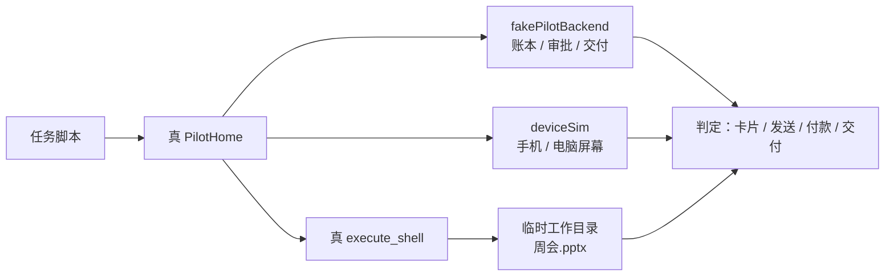

# Pilot 基准集 (Q-03)

5 个基准任务一条命令跑完，输出成功率与耗时：

```bash
node scripts/pilot-e2e/run.mjs            # 每个任务 3 次
node scripts/pilot-e2e/run.mjs --repeat 5
node scripts/pilot-e2e/run.mjs --tasks parcel-status,wechat-reply --no-json
```

任务：回一条微信 / 外卖到付款前 / 查快递 / 早报 / 电脑做一份 PPT。

## 跑的是什么

跑的是 `packages/core` 里的**真 `PilotHome`**：instructions、审批卡、`deliver_file`、工具执行器
都是生产代码；只有云端控制面、手机屏幕、pilot-data 服务是本机替身。



判定只看最终事实：手机停在哪一页、真的发出去了没有、付款点了没有、卡片写了什么、
成品是否有效并上传。不看“脚本跑到第几步”，所以漏一步、多点一下都会判失败
（反向用例在 `__tests__/pilot-e2e.test.mjs`）。

## 边界

- 这是 `sim` 模式：**不调用模型，也不连真手机**。它保证场景与 harness 链路可重复、可回归，
  但不能代替真机 + 真模型的成功率。真机/真模型模式需要云端容器与配对设备，不在本仓 CI 能力内。
- 固定“现在”为 2026-10-18 11:30（Asia/Shanghai），提醒时间参与判定，保证可重复。
- 每个任务每次跑用一个新的临时工作目录，跑完删掉（`--keep-temp` 可保留）。

## 测试

```bash
npm run build:packages
npm run test:pilot-e2e
```

`test:pilot-e2e` 带 `--test-force-exit`：工具层（`execute_shell`）会留下长连接句柄，
测试本身跑完后进程不会自己退，不是用例挂住。

结果默认写入 `scripts/pilot-e2e/results/<时间>.json`（不入库）。
